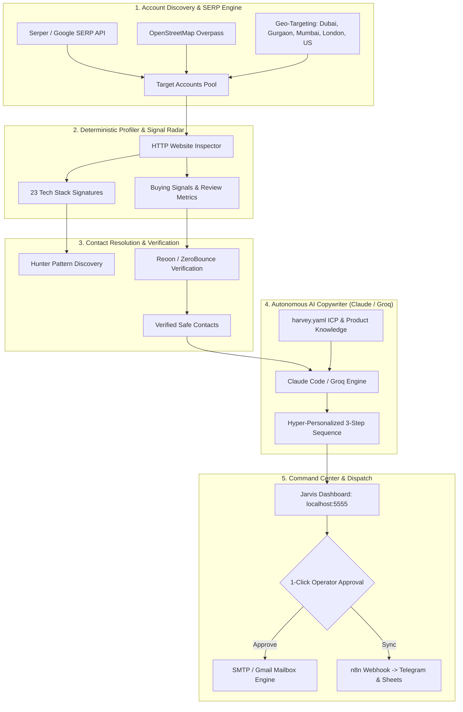

# ⚡ JARVIS SDR • Autonomous Outbound AI SDR & GTM Nervous System

> **Autonomous AI Sales SDR Engine for TrackKaro AI**  
> Finds high-value B2B decision-makers, evaluates 23 live buying signals, verifies deliverable mailboxes, crafts hyper-personalized cold outreach sequences, and automates meeting bookings. Runs locally with **$0 per-token model API costs** using Claude Code, Codex, and Groq LLMs.

---

[](https://trackkaroai.com)
[](https://jarvis.trackkaroai.com)
[](https://python.org)
[](https://github.com/astral-sh/uv)
[](https://docs.anthropic.com/en/docs/claude-code)
[](LICENSE)

---

## 🏛️ TrackKaro AI Ecosystem Architecture

TrackKaro AI operates as two complementary engines covering the full GTM lifecycle:

1. **⚡ TrackKaro Pulse (Inbound Speed-to-Lead Engine):**  
   Self-hosted n8n webhook nervous system capturing Meta/Google ad leads and connecting them to human sales reps in **< 15 seconds** via instant WhatsApp collateral, Telegram audio alerts, and real-time CRM sync.
2. **🎯 Jarvis SDR (Outbound Autonomous AI SDR):**  
   Autonomous multi-agent outbound engine that continuously identifies target accounts, scrapes decision-makers, filters by 23 live buying signals, and executes cold email campaigns with human-in-the-loop approval.

---

## 🎯 What is Jarvis SDR?

Traditional sales intelligence and outbound software (Clay, Apollo, Instantly, ZoomInfo) costs **$300–$800/month** in tool sprawl and punishes growth with expensive credit caps.

**Jarvis SDR replaces the fragmentation with an autonomous local pipeline:**

- **$0 Model API Cost**: Integrates with your active **Claude Pro/Max subscription** via headless Claude Code (`claude -p`), **Codex**, or high-speed **Groq (Llama-3.3 / GPT-OSS)**.
- **23 Live Buying Signals**: Tracks tech stack signatures (Shopify, HubSpot, Intercom, WordPress), review velocity, domain age, hiring signals, and search intent.
- **Triple-Layer Email Verification**: Resolves company email syntax patterns and verifies deliverability via Reoon, ZeroBounce, or Hunter to guarantee **< 3% bounce rate**.
- **Trojan Horse Pitch Personalization**: Generates individualized value propositions highlighting specific website bottlenecks, response latencies, and conversion leaks.
- **Human-in-the-Loop Governance**: All outgoing campaigns stage in an interactive **Approval Outbox** at `localhost:5555`. Nothing sends until you click **Approve**.
- **Multi-Workspace Client Isolation**: Built-in tenant isolation allows managing separate prospect pools for TrackKaro internal outreach and external client agency retainers.

---

## 🏗️ System Architecture



---

## ⚡ Quickstart Guide

### 1. Prerequisites & Setup
Ensure you have Python 3.12+ and [uv](https://github.com/astral-sh/uv) installed:

```bash
# Clone the repository
git clone https://github.com/mangalcool222/Jarvis.git
cd Jarvis

# Create a virtual environment using uv
uv venv --python 3.12 .venv
source .venv/bin/activate

# Install dependencies in editable mode
uv pip install -e .
```

### 2. Configure Your ICP & Offers
Review and customize `harvey.yaml`:
```yaml
persona:
  name: "Mangal Soren"
  company: "TrackKaro AI"
  role: "Lead Automation Specialist"
  email: "mangal@trackkaroai.com"

product:
  name: "TrackKaro Instant Lead Response Engine"
  pricing: "$500 - $997 Done-For-You Setup"
  offer:
    entry: "Test our live interactive simulator: https://trackkaroai.com"
    booking_url: "https://calendly.com/trackkaroai/15min"

icp:
  industries:
    - "Luxury Real Estate"
    - "Real Estate Agency & Brokerage"
    - "Performance Marketing & Lead-Gen Agencies"
    - "High-Ticket B2B SaaS"
    - "Aesthetic Clinics & MedSpas"
  geography:
    - "Dubai, UAE"
    - "Gurgaon, Haryana"
    - "Mumbai, Maharashtra"
    - "Bangalore, Karnataka"
    - "London, UK"
    - "Miami, FL"
```

### 3. Activate Buying Signals
Confirm signals to track across prospective accounts:
```bash
jarvis signals --confirm free
```

### 4. Run Autonomous Account Discovery
```bash
# Estimate cost and queries across target geographies
jarvis discover --provider serper --estimate

# Run discovery and auto-profile target accounts
jarvis discover --provider serper --limit 20
```

### 5. Launch the Command Center
```bash
# Launch Jarvis Web Dashboard
jarvis dashboard --port 5555
```
Open **`http://localhost:5555`** in your browser to:
- Review scouted companies and verified decision-makers.
- Inspect AI-drafted email sequences tailored to each prospect's website.
- 1-click **Approve**, **Reject**, or **Edit** before email dispatch.
- Monitor real-time deliverability and bounce SLAs.

---

## 📂 Multi-Workspace & Client Agency Retainers

Jarvis features built-in multi-tenant isolation. You can run separate client outreach campaigns without data collisions:

```bash
# List all active workspaces
jarvis workspace list

# Launch TrackKaro Speed-to-Lead Dashboard (Port 5555)
jarvis dashboard --port 5555

# Launch B2B Cold Email Agency Retainer Dashboard (Port 5556)
jarvis -w cold_email_outreach dashboard --port 5556

# Auto-train a new client workspace directly from their website
jarvis workspace new luxury_realty --url https://clientwebsite.com
```

---

## 📊 Sample Cold Outreach Pitch Generated by Jarvis

> **Subject:** Quick question on {{company}}'s lead response speed in {{city}}  
>
> Hi {{first_name}},  
>
> Noticed that when high-ticket buyers submit inquiry forms on {{website}}, inquiries often wait hours before receiving floorplans and pricing.  
>
> Harvard Business Review research shows that **78% of high-intent clients close with the vendor that responds within 5 minutes**. After 30 minutes, lead qualification rates drop by 391%.  
>
> We architected **TrackKaro AI** — an automated lead nervous system that delivers an interactive WhatsApp brochure in < 1.4s and sounds an urgent Telegram alert with a 1-click call button directly to your closing team.  
>
> You can test the 30-second live demo with your own phone number here:  
> 👉 **https://trackkaroai.com**  
>
> Worth a brief 15-minute chat this Thursday to see how we eliminate lead decay for luxury sales teams?  
>
> Best,  
> **Mangal Soren**  
> Lead Automation Specialist • TrackKaro AI

---

## 🔒 Safe Sending & Deliverability Guardrails

1. **Secondary Outreach Domains**: Never send cold outreach from your primary root domain (`trackkaroai.com`). Always use warmed secondary domains.
2. **Domain Authentication**: Full SPF, DKIM, DMARC, and custom tracking domain configuration.
3. **Paced Throttling**: Default send velocity is capped at **25 emails/day** per mailbox with randomized human delays.
4. **Emergency Kill-Switch**: If bounce rate exceeds 3%, Jarvis automatically halts sending queues to protect inbox reputation.

---

## 🛠️ Project Structure

```
Jarvis/
├── harvey/
│   ├── main.py              # Autonomous heartbeat loop
│   ├── brain.py             # Headless Claude Code & Groq model integration
│   ├── state.py             # SQLite data store & entity relationships
│   ├── signals.py           # 23-signal observation catalog
│   ├── pipeline.py          # Discover -> Profile -> Enrich -> Draft chaining
│   ├── gate.py              # Pre-send deliverability validation gate
│   ├── dashboard.py         # FastAPI local telemetry server
│   ├── collectors/          # Discovery providers (Serper, OSM, DataForSEO)
│   ├── agents/              # Scout, Writer, Sender, Handler, Analyst
│   ├── skills/              # Product knowledge & ICP positioning (Markdown)
│   ├── prompts/             # Agent prompts & copywriting frameworks
│   └── web/                 # Apple-grade motion dashboard UI (HTML / CSS / JS)
├── workspaces/              # Tenant isolation (trackkaro, cold_email_outreach, clients)
├── harvey.yaml              # Master ICP, persona, and channel settings
└── .env                     # Private API credentials (Git-ignored)
```

---

## 📜 License & Acknowledgments

- Built on open-source agentic primitives with inspiration from [ethanplusai/harvey](https://github.com/ethanplusai/harvey) (MIT License).
- Custom GTM architecture, 2-pillar system integration, and production deployment by **Mangal Soren** ([@mangalcool222](https://github.com/mangalcool222)).
- Part of the **TrackKaro AI** automation suite.
