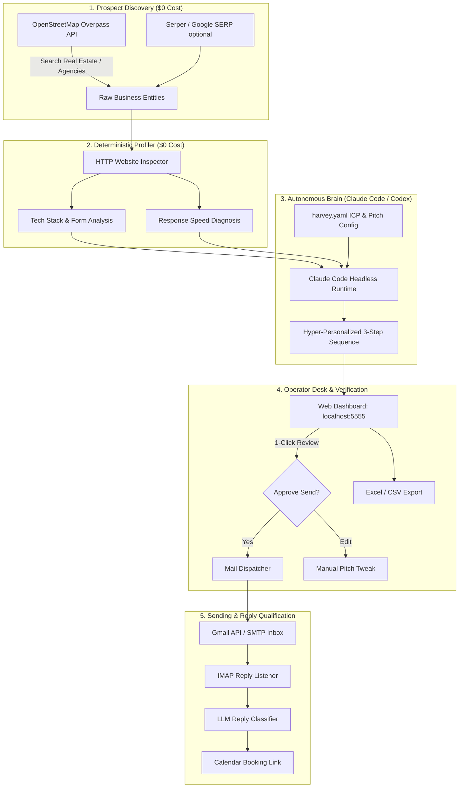

# ⚡ HARVEY AI • Autonomous Outbound GTM & Lead Generation SDR

> **Autonomous AI Sales SDR Engine for TrackKaro AI**  
> Finds high-value prospects, scans their websites, drafts personalized 3-step outreach sequences featuring the **[TrackKaro 3-Second Lead Simulator](https://demo.gtm.trackkaroai.com)**, and works conversations toward booked calendar meetings. Runs locally with **$0 per-token model API costs** using Claude Code and Codex subscriptions.

---

[](https://demo.gtm.trackkaroai.com)
[](https://python.org)
[](https://github.com/astral-sh/uv)
[](https://docs.anthropic.com/en/docs/claude-code)
[](LICENSE)

---

## 🎯 What is Harvey for TrackKaro?

Most sales automation tools (Apollo, Clay, Instantly) cost **$250–$500/month** and bill you per token for every AI draft. 

**Harvey changes the economics completely:**
- **$0 Model API Cost**: Uses your active **Claude Pro/Max subscription** via Claude Code headless CLI (`claude -p`) or your **ChatGPT subscription** via isolated Codex. No OpenAI or Anthropic API bills.
- **$0 Business Discovery**: Pulls target local businesses (Real Estate developers, luxury brokers, B2B SaaS, marketing agencies) from OpenStreetMap (OSM) without credit cards or paid keys.
- **$0 Website Profiling**: Inspects prospect websites in 3 raw HTTP requests to detect outdated contact forms, slow response speeds, missing WhatsApp widgets, and decision makers.
- **Trojan Horse Pitching**: Automatically injects a personalized challenge into every cold email, inviting prospects to test their own phone number on the **[TrackKaro 3-Second Live Simulator](https://demo.gtm.trackkaroai.com)**.
- **Human-in-the-Loop Safeguard**: Operates with a strict outbox approval gate at `localhost:5555`. Nothing sends until you click **Approve**.

---

## 🏗️ System Architecture



---

## ⚡ Quickstart Guide

### 1. Prerequisites & Setup
Make sure you have [uv](https://github.com/astral-sh/uv) and Python 3.12+ installed:

```bash
# Clone the repository
git clone https://github.com/mangalcool222/harvey.git
cd harvey

# Create a virtual environment using uv with Python 3.12
uv venv --python 3.12 .venv
source .venv/bin/activate

# Install dependencies in editable mode
uv pip install -e .
```

### 2. Configure Your TrackKaro ICP
Review and tune `harvey.yaml`:
```yaml
persona:
  name: "Mangal Soren"
  company: "TrackKaro AI"
  role: "Growth & Automation Systems"
  email: "mangal@trackkaroai.com"

product:
  name: "TrackKaro 3-Second Lead Automation Engine"
  offer:
    entry: "Test our live interactive simulator: https://demo.gtm.trackkaroai.com"
    booking_url: "https://calendly.com/trackkaroai/15min"

icp:
  industries:
    - "Real Estate"
    - "Luxury Real Estate"
    - "Property Management"
    - "B2B SaaS"
    - "Marketing Agency"
  geography:
    - "Gurgaon, India"
    - "Bangalore, India"
    - "Mumbai, India"
    - "Dubai, UAE"
```

### 3. Activate Free Prospecting Signals
Activate all 21 zero-cost signals:
```bash
harvey signals --confirm free
```

### 4. Discover Businesses ($0 Cost)
Run discovery for your target ICP:
```bash
# Estimate projected cost first (always $0 for OSM)
harvey discover --provider osm --estimate

# Find 20 real estate / agency prospects and auto-profile them
harvey discover --provider osm --limit 20
```

### 5. Launch the Web Dashboard
```bash
harvey dashboard
```
Open **`http://localhost:5555`** in your browser to:
- Review discovered leads and their analyzed tech stacks.
- Read AI-drafted email sequences tailored to their specific website pain points.
- 1-click **Approve**, **Reject**, or **Edit** before sending.

### 6. Export to Excel / CSV
Export all collected leads anytime for manual review in Excel or Google Sheets:
```bash
harvey export --out trackkaro_leads.csv
```

### 7. Multi-Product & Client Workspaces (Agency Mode)
You can run Harvey for multiple clients or products with completely isolated leads, databases, and emails:
```bash
# List all workspaces
harvey workspace list

# Create a new workspace for another product / client
harvey workspace new saas_app

# Or auto-train a new client workspace directly from their website:
harvey workspace new saas_app --url https://clientwebsite.com

# Run Harvey for that specific workspace:
harvey run -w saas_app

# Launch dashboard for that client on a different port:
harvey dashboard -w saas_app --port 5556
```

---

## 📊 Sample Cold Pitch Generated by Harvey

> **Subject:** Quick question about {{company}}'s contact form response speed  
>
> Hi {{first_name}},  
>
> Noticed that when high-ticket buyers fill out the inquiry form on {{website}}, they typically wait several hours before receiving property floorplans and pricing.  
>
> Data shows that **78% of luxury real estate buyers buy from the first broker who responds within 5 minutes**. After 30 minutes, lead qualification drops by 391%.  
>
> We built **TrackKaro AI** — an automation engine that delivers an instant VIP WhatsApp brochure in < 1.4s and sounds a Telegram alert with a 1-click call button to your sales team in < 2.4s.  
>
> Test our live 30-second interactive simulator with your own phone number here:  
> 👉 **https://demo.gtm.trackkaroai.com**  
>
> Worth a 15-minute chat this Thursday to see how we cut lead leaks for real estate developers?  
>
> Best,  
> **Mangal Soren**  
> Growth & Automation Systems • TrackKaro AI

---

## 🔒 Safe Sending Rules & Deliverability

1. **Dedicated Domain**: Never send cold outreach from your primary corporate domain (`trackkaroai.com`). Always use secondary outreach domains (e.g. `gettrackkaro.com`, `trackkaroteam.com`).
2. **Domain Authentication**: Ensure SPF, DKIM, and DMARC records are configured.
3. **Daily Volume Cap**: Default ceiling is set to **25 emails/day** per inbox (`max_daily_sends: 25`).
4. **Kill Switch**: If bounce rate exceeds 3%, Harvey automatically pauses all sending queues.

---

## 🛠️ Project Structure

```
harvey/
├── main.py              # Heartbeat autonomous loop
├── brain.py             # Claude Code & Codex headless runtime integration
├── codex.py             # Isolated ChatGPT Codex client
├── state.py             # SQLite data store (data/harvey.db)
├── signals.py           # 23-signal detection catalog
├── pipeline.py          # Discover → Profile → Draft chaining
├── gate.py              # Deterministic pre-send gate & safety checks
├── dashboard.py         # FastAPI web server (localhost:5555)
├── collectors/
│   ├── discover.py      # Multi-provider business discovery (OSM, DataForSEO, Serper)
│   └── profile.py       # Zero-cost HTTP website profiler
├── agents/              # Scout, Writer, Sender, Handler, Analyst
├── skills/              # Sales knowledge & ICP rules (Markdown)
├── prompts/             # Agent prompts & message templates
└── web/                 # Dashboard UI (HTML / Tailwind CSS / Vanilla JS)
```

---

## 📜 License & Credits

- Built upon the open-source foundations of [ethanplusai/harvey](https://github.com/ethanplusai/harvey) (MIT License).
- Customizations, GTM blueprints, and TrackKaro integration by **Mangal Soren** ([@mangalcool222](https://github.com/mangalcool222)).
- Part of the **TrackKaro AI** automation ecosystem.
